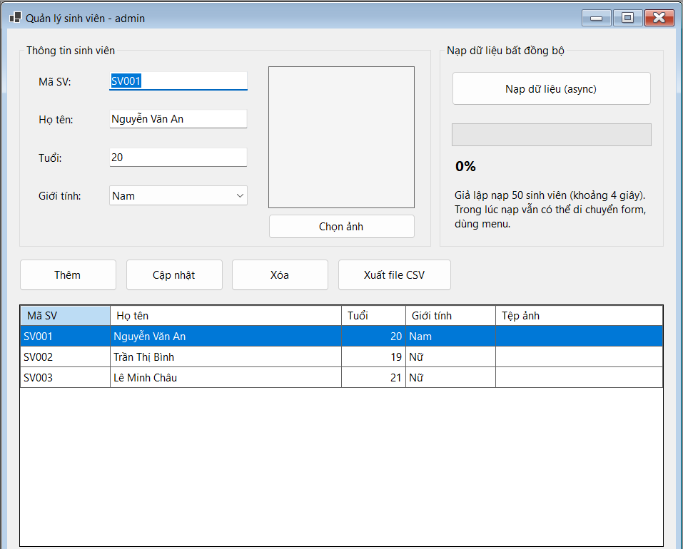
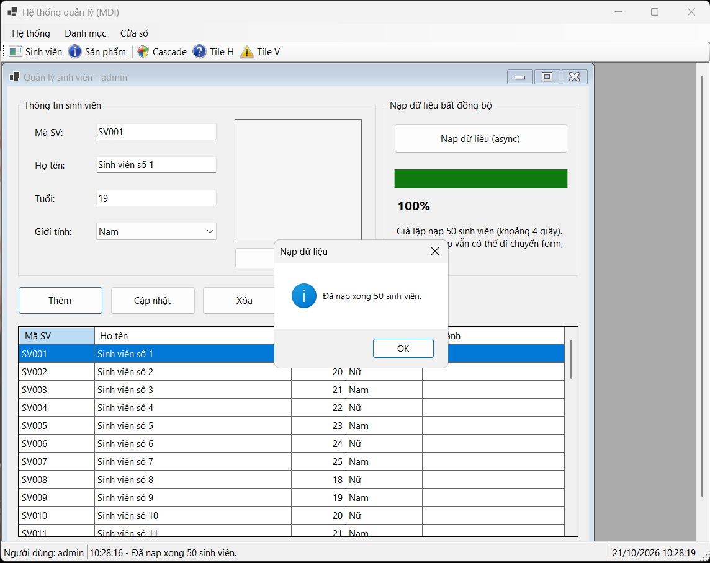

## THÔNG TIN SINH VIÊN 
- **Họ và tên:** Phạm Huy Hoàng
- **Mã số sinh viên:** 24810340415
- **Lớp:** D19CNPM3
- **Tên môn học:** Lập trình C# / Windows Forms 
- **Tên bài tập:** BÀI 4.8: LẬP TRÌNH BẤT ĐỒNG BỘ (ASYNC/AWAIT) & TIẾN TRÌNH PROGRESSBAR
--- 
## KẾT QUẢ THỰC HÀNH 
### 1. Ảnh màn hình Giao diện chính 
 
### 2. Ảnh màn hình Chức năng thực thi / Kết quả 
 

